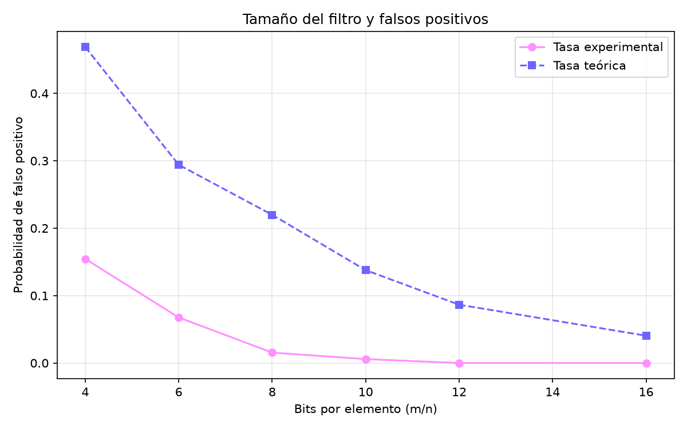

# Filtro de Bloom para consultar municipios de Colombia

## Descripción

Este proyecto implementa un filtro de Bloom desde cero en Python y lo aplica a la consulta de nombres de municipios de Colombia. Un filtro de Bloom es una estructura de datos probabilística que responde si un elemento **posiblemente pertenece** a un conjunto o si **definitivamente no pertenece**, usando muy poca memoria. A cambio, admite falsos positivos, pero nunca produce falsos negativos (si no se eliminan elementos).

El objetivo es comprobar experimentalmente tres cosas:

1. Que el filtro no genera falsos negativos.
2. Que la tasa de falsos positivos coincide con la probabilidad teórica.
3. Cuánta memoria ahorra frente a un `set` de Python, y a qué costo en tiempo.

Trabajo del curso **Estructura de Datos** (Equipo 4: estructuras de datos probabilísticas y filtros de Bloom), Ingeniería en Ciencia de Datos, ITM.

## Dataset

- **Fuente:** [DIVIPOLA - Códigos municipios](https://www.datos.gov.co/Mapas-Nacionales/DIVIPOLA-C-digos-municipios/gdxc-w37w/about_data) (datos abiertos de Colombia con la división político-administrativa: departamentos y municipios).
- **Archivo:** `datos/municipios.csv`.
- **Contenido:** código y nombre del departamento, código y nombre del municipio, tipo, longitud y latitud.
- **Uso en el proyecto:** solo se utiliza la columna `Nombre Municipio`. Los nombres se pasan a minúsculas, se les quitan las tildes y se eliminan los duplicados, lo que deja **1.036 nombres únicos**.

## Tecnologías

- Python 3
- matplotlib (gráfica de resultados)
- Módulos estándar: `csv`, `math`, `random`, `time`, `unicodedata`, `os`, `sys`

Las dependencias están en `requirements.txt`.

## Implementación

El filtro está en `resultados/bloom.py` (clase `FiltroBloom`):

- **Arreglo de bits compacto:** un `bytearray` donde cada byte guarda 8 bits.
- **Tamaño óptimo:** dados `n` elementos y una tasa de error `p`, se calcula `m = -n · ln(p) / (ln 2)²`.
- **Número de funciones hash:** `k = (m / n) · ln 2`.
- **Función hash:** FNV-1a de 32 bits (XOR con cada byte y multiplicación por 16777619).
- **Generación de las k posiciones:** se calcula FNV-1a sobre el texto `"i:elemento"` para cada `i` de 0 a `k-1` y se aplica una mezcla final de bits (fmix32). Sin esa mezcla, los hashes de entradas que solo difieren en un carácter quedan muy correlacionados y la tasa de falsos positivos real se dispara por encima de la teórica. Cada hash se convierte en posición con `hash % m`.
- **Inserción:** se activan en 1 las `k` posiciones del elemento y se incrementa el contador de elementos insertados.
- **Consulta:** si alguna de las `k` posiciones está en 0, el elemento definitivamente no está; si todas están en 1, posiblemente está.
- **Probabilidad teórica de falso positivo:** `p ≈ (1 - e^(-k·n/m))^k`, donde `n` es la cantidad de elementos realmente insertados.

El programa principal (`resultados/main.py`) divide los municipios al azar en dos mitades (semilla fija 42): una mitad se inserta en el filtro y la otra sirve para medir falsos positivos. Luego ejecuta:

1. Creación del filtro e inserción, con medición de memoria y tiempo.
2. Comprobación de falsos negativos.
3. Medición de falsos positivos reales frente a la tasa teórica.
4. Comparación de tiempos de consulta entre el filtro y un `set`.
5. Experimento variando los bits por elemento (`m/n` de 4 a 16) y generación de la gráfica.
6. Consulta interactiva por nombre de municipio.

## Ejecución

Clonar el repositorio e instalar las dependencias:

```bash
git clone https://github.com/DanielaZapata/Estructuras_probabilisticas_y_filtros_de_Bloom.git
cd Estructuras_probabilisticas_y_filtros_de_Bloom
pip install -r requirements.txt
```

Ejecutar desde la carpeta principal del proyecto:

```bash
python resultados/main.py
```

Al terminar, el programa pide el nombre de un municipio. Como solo la mitad de los municipios (elegidos al azar) se inserta en el filtro, un municipio real puede responder "definitivamente no está en el filtro". Es el comportamiento esperado.

También puede ocurrir un falso positivo. Por ejemplo, al consultar `aracataca` (que no se insertó), el filtro responde que posiblemente está registrado, y la comparación con el conjunto real confirma que fue un falso positivo.

## Estructura del proyecto

```
Estructuras_probabilisticas_y_filtros_de_Bloom/
├── datos/
│   └── municipios.csv
├── resultados/
│   ├── bloom.py
│   ├── main.py
│   └── comparacion_falsos_positivos.png
├── requirements.txt
└── README.md
```

## Resultados

Resultados de una ejecución con 1.036 municipios (518 insertados y 518 no insertados), con una tasa de error objetivo de 1 %:

| Medida | Filtro de Bloom | `set` de Python |
|---|---|---|
| Tamaño del arreglo | 4.966 bits (k = 7) | - |
| Memoria | 621 bytes | 63.063 bytes |
| Tiempo de 518 consultas | 0,0098 s | 0,000076 s |
| Falsos negativos | 0 | 0 |
| Falsos positivos | 7 de 518 (1,35 %) | 0 |

- **Sin falsos negativos:** todos los municipios insertados fueron reconocidos.
- **Falsos positivos:** la tasa real (1,35 %) se acerca a la teórica (1,00 %). La diferencia es normal: con 518 consultas, un solo falso positivo cambia la tasa en 0,19 puntos porcentuales.
- **Memoria:** el filtro ocupa unas 100 veces menos que el `set`.
- **Tiempo:** el `set` es mucho más rápido. Esto se debe a que el `set` es una estructura nativa de Python, implementada en C, mientras que el filtro está escrito en Python puro y calcula `k` hashes por consulta. La ventaja del filtro es la memoria, no la velocidad.

### Efecto del tamaño del arreglo

Al aumentar los bits por elemento (`m/n`), la tasa de falsos positivos baja, y la tasa experimental sigue de cerca a la teórica:

| m/n | k | Tasa real | Tasa teórica |
|---|---|---|---|
| 4 | 3 | 15,44 % | 14,69 % |
| 6 | 4 | 6,76 % | 5,61 % |
| 8 | 6 | 1,54 % | 2,16 % |
| 10 | 7 | 0,58 % | 0,82 % |
| 12 | 8 | 0,00 % | 0,31 % |
| 16 | 11 | 0,00 % | 0,05 % |

Con `m/n` = 12 y 16 la tasa real dio 0 %, porque con 518 consultas se esperarían solo unos 1,6 y 0,2 falsos positivos respectivamente; es normal que no aparezca ninguno.



## Autores

- Jimena Hurtado Reyes
- María Camila Hurtado Reyes
- Laura Sofía Diaz Henao
- Daniela Zapata Gutierrez